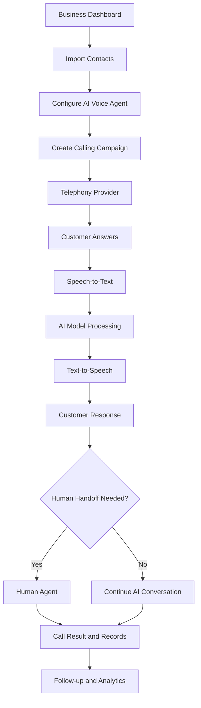

# OmniCall AI

**AI-Powered Voice Calling, Telemarketing & Communication Automation Platform**

**Live Project:** [https://omnicallai.kartikcomtech.in/](https://omnicallai.kartikcomtech.in/)

[](https://omnicallai.kartikcomtech.in/)

OmniCall AI is a cloud-based communication platform designed to bring voice calling, AI-powered conversations, telemarketing campaigns, SMS communication, contact management, and customer engagement into one ecosystem.

It combines configurable AI voice agents, automated calling workflows, telephony integrations, CRM-oriented contact management, follow-up sequences, and campaign analytics to help teams manage customer communication more efficiently.

<p align="center">
  
  
  
  
  
  
</p>

---

## Table of Contents

- [Live Demo](#live-demo)
- [Overview](#overview)
- [Key Features](#key-features)
- [AI Voice and Calling Workflow](#ai-voice-and-calling-workflow)
- [Technology Stack](#technology-stack)
- [Architecture](#architecture)
- [Integrations](#integrations)
- [Requirements](#requirements)
- [Getting Started](#getting-started)
- [Environment Configuration](#environment-configuration)
- [Background Services](#background-services)
- [API Documentation](#api-documentation)
- [Project Structure](#project-structure)
- [Testing and Code Quality](#testing-and-code-quality)
- [Deployment Notes](#deployment-notes)
- [Security and Responsible Use](#security-and-responsible-use)
- [Documentation](#documentation)
- [Contributing](#contributing)
- [License](#license)

---

## Live Demo

Explore the deployed OmniCall AI project: [https://omnicallai.kartikcomtech.in/](https://omnicallai.kartikcomtech.in/).

## Overview

Traditional business communication can involve disconnected tools, repetitive manual calls, fragmented customer records, and limited visibility into campaign performance.

OmniCall AI is designed to address these challenges through a unified platform for:

- AI-assisted inbound and outbound voice conversations.
- Automated telemarketing and calling campaigns.
- SMS communication and follow-up workflows.
- Contact, lead, and campaign management.
- Human handoff and call monitoring.
- Call records, recordings, and performance analytics.
- Configurable telephony and third-party service integrations.

The platform is intended for small and medium-sized businesses, sales teams, contact centres, telemarketing agencies, customer-support teams, startups, and service organisations.

## Key Features

### AI Voice Agents

- Configure AI agents for inbound and outbound communication.
- Connect language models through OpenRouter.
- Support speech-to-text processing through Deepgram.
- Configure text-to-speech services and voice settings.
- Provide agent-specific instructions and knowledge-base content.
- Stream conversation audio and responses through supported real-time services.
- Monitor conversations and transcripts during calls.
- Support transfer or escalation to a human operator where configured.
- Track AI usage and call-related costs.

### Voice Calling and Telemarketing

- Create and manage outbound calling campaigns.
- Use text-to-speech or uploaded audio for campaign messages.
- Schedule campaigns and follow-up activity.
- Import contacts and organise them into contact lists.
- Track call outcomes and campaign progress.
- Support call recording and playback where enabled.
- Support DTMF input and answering-machine detection where supported by the selected provider.
- Use the browser softphone with the supported WebRTC provider integration.

### SMS Communication

- Create SMS campaigns for contact lists.
- Send and receive SMS through the configured telephony provider.
- Manage two-way message conversations.
- Use reusable SMS templates.
- Configure AI-assisted SMS responses where enabled.
- Track message activity and delivery information exposed by the provider.

### Contact and CRM Management

- Manage contacts and customer information centrally.
- Organise contacts using lists, tags, and custom fields.
- Import and export contact data using CSV workflows.
- Maintain lead and customer interaction records.
- Connect external CRM or business systems through APIs and webhooks.

### Follow-up Automation

- Create multi-step follow-up sequences.
- Configure message variants for campaign optimisation.
- Schedule follow-up activity.
- Use sentiment and call-outcome analysis to support follow-up decisions.
- Coordinate automated workflows with human assistance.

### Analytics and Administration

- Review campaign and communication activity.
- Monitor call and SMS records.
- View operational metrics and usage information.
- Configure pricing and credit-based usage settings.
- Manage users, roles, and permissions.
- Support KYC workflows and verification statuses.
- Configure platform branding and supported languages.
- Maintain activity and audit records.
- Use real-time updates through Laravel Reverb when configured.

### Platform and Business Features

- Multi-user roles for administrators, customers, and agents.
- Two-factor authentication support.
- Credit-based billing and usage tracking.
- Phone-number management and provider synchronisation.
- Payment gateway integrations.
- REST API and webhook-based integration points.
- Multi-language interface support.
- Error monitoring through Sentry when configured.

> **Integration note:** Availability of calling, SMS, payment, AI, recording, WebRTC, and other provider-specific capabilities depends on the credentials, account permissions, region, configuration, and provider selected for the installation.

---

## AI Voice and Calling Workflow

A typical AI-assisted outbound calling workflow is:

1. **Business login** – The user signs in to the platform.
2. **Upload contacts** – Contacts are imported and organised into lists.
3. **Configure AI agent** – The user defines the agent's instructions, model, voice, and knowledge source.
4. **Create campaign** – A campaign is configured with its target contacts and calling settings.
5. **Start calling** – The application initiates calls through the configured telephony provider.
6. **Speech recognition** – Incoming speech is transcribed through the configured speech service.
7. **AI processing** – The language model generates a response using the agent configuration and available context.
8. **Voice response** – The configured text-to-speech service generates spoken output.
9. **Customer interaction** – The conversation continues, or it is transferred to a human when configured.
10. **Follow-up and analytics** – Call outcomes and interaction data can be used for reporting and follow-up workflows.



---

## Technology Stack

The following stack is reflected in the supplied application source and project material.

| Layer | Technologies | Purpose |
|---|---|---|
| Backend | PHP 8.2+, Laravel 12 | Application logic, services, APIs, jobs |
| Frontend | React 19, TypeScript | Interactive user interface |
| Application bridge | Inertia.js 2 | React pages with Laravel routing |
| Styling | Tailwind CSS 4, Radix UI-based components | Responsive interface and UI components |
| Build tooling | Vite 7 | Frontend development and production builds |
| Database | MySQL / MariaDB | Persistent application data |
| Cache and queues | Laravel queue system, Redis/Predis where configured | Background processing and caching |
| Real-time | Laravel Reverb | WebSocket-based updates |
| Telephony | Twilio or Plivo | Voice, SMS, and telephony services |
| Browser calling | Twilio Voice SDK / Plivo Browser SDK | WebRTC-based browser calling |
| AI orchestration | OpenRouter | Access to supported language models |
| Speech recognition | Deepgram | Speech-to-text |
| Text-to-speech | Configurable TTS integration; OpenAI TTS settings are present in the application configuration | Spoken AI responses |
| API documentation | L5 Swagger / OpenAPI | API documentation |
| Monitoring | Sentry | Error and performance monitoring |
| Payments | Stripe, Razorpay and other configured gateway modules | Payment processing |

### AI and Speech Services

The project material identifies integrations and research around:

- **OpenRouter** – Language-model access, including supported GPT, Gemini, and Llama model options.
- **Deepgram** – Speech recognition and transcription.
- **Text-to-speech** – Voice generation through configured TTS services.
- **Twilio / Plivo** – Telephony connectivity for calls and messaging.

The actual models and provider capabilities available to an installation depend on the API credentials and service configuration.

---

## Architecture

At a high level, the platform is organised into the following layers:

| Layer | Responsibility |
|---|---|
| User interface | Admin, customer, and agent-facing screens |
| Laravel application | Authentication, business rules, campaign management, contacts, billing, and APIs |
| AI services | Model requests, speech recognition, response generation, and voice output |
| Telephony layer | Provider abstraction and voice/SMS communication |
| Automation layer | Queued jobs, scheduled campaigns, and follow-up sequences |
| Data layer | Users, contacts, campaigns, call records, messages, settings, and related data |
| Integration layer | Webhooks, payment gateways, CRM connections, and external services |

The application includes telephony provider contracts and provider-specific integrations. This allows telephony-related operations to be handled through application interfaces while using the selected provider implementation.

---

## Integrations

| Integration | Role | Configuration |
|---|---|---|
| Twilio | Voice, SMS, phone numbers, and supported telephony features | Provider credentials |
| Plivo | Voice, SMS, and supported telephony features | Provider credentials |
| OpenRouter | LLM access for AI agents | API key and model settings |
| Deepgram | Speech-to-text | API key and speech settings |
| OpenAI | TTS configuration and related AI services | API key and TTS settings |
| Laravel Reverb | Real-time events | Reverb environment variables |
| Stripe | Payment processing | API and webhook credentials |
| Razorpay | Payment processing | API and webhook credentials |
| Sentry | Error monitoring | DSN and environment settings |
| SMTP | Email delivery | Mail server credentials |
| External CRM systems | Data exchange and workflow integration | API endpoints and webhooks |

**Telephony provider selection:** The supplied application documentation states that an installation selects Twilio or Plivo during setup and is locked to that provider choice. Provider-specific features may differ.

---

## Requirements

### Server Requirements

| Component | Minimum / Supported |
|---|---|
| PHP | 8.2 or later; PHP 8.3+ recommended |
| Laravel | 12.x |
| Node.js | 18+; 20.x LTS recommended |
| Composer | 2.x |
| Database | MySQL 8+ or MariaDB 10.5+ |
| Web server | Apache 2.4+ or Nginx |
| RAM | 2 GB minimum; 4 GB+ recommended |
| Storage | 20 GB minimum; more for recordings and uploaded files |

### PHP Extensions

Ensure the PHP extensions required by Laravel and the installed packages are enabled. The application documentation lists the following core extensions:

```text
BCMath
Ctype
cURL
DOM
Fileinfo
JSON
Mbstring
OpenSSL
PDO
PDO MySQL
Tokenizer
XML
```

Additional extensions may be required by optional integrations or deployment configuration.

### External Accounts

For the features you intend to use, prepare the relevant service accounts and API credentials:

- Twilio or Plivo for telephony.
- OpenRouter for LLM-powered agents.
- Deepgram for speech recognition.
- A configured text-to-speech provider.
- Stripe or Razorpay for payment processing, if required.
- SMTP credentials for email delivery.
- Redis, if used for production queues, cache, or sessions.

---

## Getting Started

### 1. Clone the Repository

```bash
git clone https://github.com/<your-username>/<your-repository>.git
cd <your-repository>
```

Replace the repository URL with your GitHub repository URL.

### 2. Install Backend Dependencies

```bash
composer install
```

### 3. Configure Environment

```bash
cp .env.example .env
php artisan key:generate
```

Open `.env` and configure your database, application URL, queue, mail, AI, telephony, and other required service credentials.

### 4. Create the Database

Create a MySQL or MariaDB database and update the database settings in `.env`:

```env
DB_CONNECTION=mysql
DB_HOST=127.0.0.1
DB_PORT=3306
DB_DATABASE=omnicall_ai
DB_USERNAME=your_database_user
DB_PASSWORD=your_database_password
```

### 5. Run Migrations

```bash
php artisan migrate
```

If you are setting up a fresh environment, review the project's installation and seeding workflow before running optional seeders.

### 6. Install Frontend Dependencies

```bash
npm install
```

### 7. Build Frontend Assets

For development:

```bash
npm run dev
```

For production:

```bash
npm run build
```

### 8. Link Public Storage

```bash
php artisan storage:link
```

### 9. Start the Application

In one terminal:

```bash
php artisan serve
```

In another terminal, run the queue worker:

```bash
php artisan queue:work --tries=3
```

For local development, the repository also provides a Composer development script:

```bash
composer dev
```

This starts the Laravel development server, queue listener, and Vite development server concurrently.

Open the local URL printed by Laravel (commonly `http://127.0.0.1:8000`).

> **Important:** The supplied application package includes a guided web installer and additional deployment scripts. Follow the installation instructions shipped with the application for the intended installer-based setup. Do not run destructive reset or provider-switching operations on a live installation without reviewing their effects.

---

## Environment Configuration

The repository includes an `.env.example` file. The following are representative settings; configure only the services you use.

### Application

```env
APP_NAME="OmniCall AI"
APP_ENV=local
APP_DEBUG=true
APP_URL=http://localhost:8000
APP_TIMEZONE=UTC
```

For production, set `APP_ENV=production` and `APP_DEBUG=false`.

### Database

```env
DB_CONNECTION=mysql
DB_HOST=127.0.0.1
DB_PORT=3306
DB_DATABASE=omnicall_ai
DB_USERNAME=your_database_user
DB_PASSWORD=your_database_password
```

### Queue, Cache, and Broadcasting

```env
QUEUE_CONNECTION=database
CACHE_STORE=database
SESSION_DRIVER=database
BROADCAST_CONNECTION=reverb
```

Redis can be configured where required by your deployment.

### Telephony

Select the provider supported by your installation:

```env
TELEPHONY_PROVIDER=twilio
```

For Twilio:

```env
TWILIO_ACCOUNT_SID=
TWILIO_AUTH_TOKEN=
TWILIO_PHONE_NUMBER=
```

For Plivo:

```env
PLIVO_AUTH_ID=
PLIVO_AUTH_TOKEN=
```

Use the provider configuration screen or the installation guide supplied with the application where applicable. Do not commit real credentials to Git.

### AI and Speech

```env
DEEPGRAM_API_KEY=

OPENAI_API_KEY=
OPENAI_TTS_MODEL=tts-1
OPENAI_TTS_VOICE=alloy

OPENROUTER_API_KEY=
AI_AGENT_DEFAULT_MODEL=
AI_AGENT_MAX_TOKENS=500
AI_AGENT_TEMPERATURE=0.7
```

Use model identifiers and voice options supported by your provider account and the application configuration.

### Real-time Services

```env
REVERB_APP_ID=
REVERB_APP_KEY=
REVERB_APP_SECRET=
REVERB_HOST=localhost
REVERB_PORT=8080
REVERB_SCHEME=http

VITE_REVERB_APP_KEY="${REVERB_APP_KEY}"
VITE_REVERB_HOST="${REVERB_HOST}"
VITE_REVERB_PORT="${REVERB_PORT}"
VITE_REVERB_SCHEME="${REVERB_SCHEME}"
```

### Payments and Monitoring

Configure the relevant Stripe, Razorpay, or other supported gateway variables from `.env.example`. Configure Sentry DSNs if error monitoring is required.

> Never publish `.env`, API keys, provider tokens, database passwords, private certificates, or production credentials in a public repository.

---

## Background Services

Background processing is important for campaign execution and scheduled workflows.

| Service | Responsibility |
|---|---|
| Laravel queue worker | Processes queued campaigns, imports, messages, and other background jobs |
| Laravel scheduler | Runs scheduled campaigns, follow-up tasks, and recurring application jobs |
| Laravel Reverb | Provides real-time WebSocket updates when enabled |

### Run a Queue Worker

```bash
php artisan queue:work --tries=3
```

### Run the Scheduler in Development

```bash
php artisan schedule:work
```

### Configure the Production Scheduler

Add the following cron entry, adjusting the application path:

```cron
* * * * * cd /path/to/omnicall-ai && php artisan schedule:run >> /dev/null 2>&1
```

For production, use a process manager such as Supervisor, Systemd, or PM2 to keep queue workers running and restart them when necessary. Configure Reverb separately if your deployment uses it.

---

## API Documentation

The application includes REST API functionality and L5 Swagger/OpenAPI support.

After starting and configuring the application, the Swagger UI is commonly available at:

```text
https://your-domain.com/api/documentation
```

Generate the API documentation with:

```bash
php artisan l5-swagger:generate
```

The final endpoint and access permissions depend on the deployed application's route and Swagger configuration.

---

## Project Structure

A simplified view of the main Laravel application directories:

```text
.
├── app/
│   ├── Console/          # Artisan commands and scheduled operations
│   ├── Contracts/        # Interfaces, including telephony contracts
│   ├── Enums/            # Application enums
│   ├── Helpers/          # Shared helper classes
│   ├── Http/             # Controllers, middleware, and requests
│   ├── Listeners/        # Event listeners and integrations
│   ├── Models/           # Eloquent models
│   ├── Services/         # Business and integration services
│   └── Support/          # Application support utilities
├── bootstrap/
├── config/
├── database/
│   ├── migrations/
│   ├── factories/
│   └── seeders/
├── docs/
├── public/
├── resources/
│   ├── js/               # React and TypeScript frontend
│   └── views/
├── routes/
├── scripts/
├── storage/
├── .env.example
├── artisan
├── composer.json
├── package.json
└── vite.config.ts
```

This is a high-level guide; individual modules and files may vary as the project evolves.

---

## Testing and Quality Assurance

Use the following checks during development and before deployment. Run them from the project root.

### Code and Build Checks

```bash
# Confirm that Laravel boots and displays application information
php artisan about

# Run the Laravel test runner
php artisan test

# Check TypeScript types
npm run types

# Check frontend formatting
npm run format:check

# Build optimized frontend assets
npm run build

# Apply the PHP formatter
./vendor/bin/pint
```

The project also provides a Composer test shortcut:

```bash
composer test
```

### Application Verification Checklist

Validate the main user journeys in a staging environment with test accounts and sandbox provider credentials:

- [ ] Sign in, sign out, password reset, and role-based access.
- [ ] Create, update, import, export, and search contacts.
- [ ] Configure an AI voice agent, its instructions, model, voice, and knowledge base.
- [ ] Verify AI provider connectivity and handle unavailable-model responses.
- [ ] Place an outbound test call through the selected telephony provider.
- [ ] Verify inbound call handling when enabled.
- [ ] Check speech-to-text transcription and text-to-speech playback.
- [ ] Verify call termination and human handoff where configured.
- [ ] Send and receive test SMS messages where supported.
- [ ] Schedule a campaign and confirm queue processing and follow-up execution.
- [ ] Review call records, recordings, campaign results, and access permissions.
- [ ] Verify payment flows in test mode and validate webhook handling where enabled.
- [ ] Test invalid credentials, provider timeouts, rate limits, and network failures.

### Automated Test Coverage

Add and maintain application-level unit and feature tests as modules evolve. Prioritise authentication and permissions, contact management, campaign scheduling, telephony provider adapters, webhook validation, billing, and AI-service error handling. Mock external providers in automated tests so test runs never place real calls, send real SMS messages, or incur third-party charges.

Run the relevant checks before merging changes or publishing a release. Record actual test results in pull requests or release notes.

---

## Deployment Notes

For production deployments:

1. Use a supported PHP version and install all required PHP extensions.
2. Configure the web server document root to the Laravel `public/` directory.
3. Set `APP_ENV=production` and `APP_DEBUG=false`.
4. Configure database access, mail, queue, cache, and required provider credentials.
5. Build frontend assets using `npm run build`.
6. Set appropriate ownership and permissions for `storage/` and `bootstrap/cache/`.
7. Enable HTTPS and configure trusted hosts and allowed origins appropriately.
8. Run queue workers under a process manager.
9. Configure the Laravel scheduler through cron or a managed scheduler process.
10. Configure backups, logs, monitoring, and provider webhooks.
11. Verify real inbound/outbound calls, SMS, AI conversations, and payment callbacks in a test environment before production use.

The application package contains additional deployment and installation documentation. Review those files before deploying to shared hosting or cPanel, because available process-management and WebSocket capabilities differ between hosting providers.

---

## Security and Responsible Use

OmniCall AI can be used to automate communication with customers and contacts. Operators are responsible for using it lawfully and transparently.

- Obtain the consent or other lawful basis required before contacting people.
- Follow applicable telemarketing, Do Not Call, privacy, and data-protection requirements in each target region.
- Identify automated or AI-generated interactions where required by law or policy.
- Respect opt-out requests and maintain suppression lists.
- Protect recordings, transcripts, contact data, and knowledge-base documents.
- Restrict access using appropriate roles and permissions.
- Store secrets in environment variables or a secure secrets manager.
- Use HTTPS and secure webhook verification.
- Apply rate limits and monitor unusual calling or messaging activity.
- Review provider policies, regional restrictions, and usage limits before launching campaigns.

---

## Documentation

The supplied project includes additional documentation:

| File | Description |
|---|---|
| `CHANGELOG.md` | Release history and changes |
| `docs/documentation.html` | Product documentation and usage guide |
| `docs/telephony-live-verification.md` | Checklist for validating telephony workflows against a real provider account |
| `.env.example` | Example environment configuration |

For provider-specific behaviour and deployment details, consult the documentation included in the repository and the official documentation of each external service.

---

## Collaboration and Contributing

A consistent contribution workflow helps keep the codebase maintainable and makes development easier to review.

1. Keep the `main` branch stable.
2. Create a focused branch for each feature, fix, or documentation update (for example, `feature/ai-agent-setup` or `fix/call-status-handling`).
3. Make small commits with clear messages describing the actual change.
4. Open pull requests with a summary, relevant screenshots or logs, testing details, and linked issues where applicable.
5. Request a review from another contributor before merging.
6. Update tests and documentation when application behaviour changes.
7. Keep `CHANGELOG.md` updated for user-facing changes.

Contributions are welcome when you have permission to work on this codebase.

Please do not include credentials, customer data, call recordings, or other private information in commits or pull requests.

---

## License

The source package's existing README labels the application as **Proprietary**. Unless the project owner has explicitly chosen and included an open-source license, do not assume that the code is available for unrestricted reuse, modification, or redistribution.

For licensing and commercial-use permissions, contact the project owner.

---

<p align="center">
  <strong>OmniCall AI</strong><br>
  Intelligent Voice Calling • AI Automation • Customer Communication
</p>
